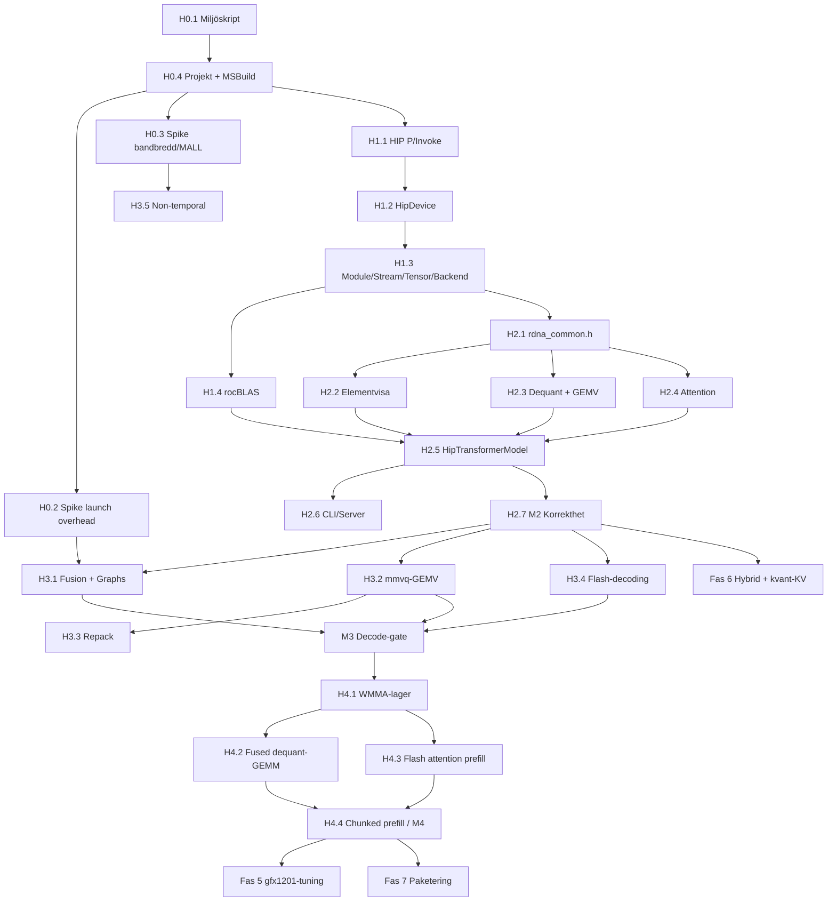

# Implementationsplan – `DotLLM.Hip`

> **Primärt mål:** RX 7900 XTX (`gfx1100`). **Sekundärt:** RX 9070 XT (`gfx1201`). Windows 11, HIP SDK **7.2.3** (låst).
> Läs först [HIP_PITFALLS.md](HIP_PITFALLS.md). Varje arbetspaket (Hx.y) motsvarar **en GitHub-issue, en branch och en PR** enligt [CLAUDE.md](../CLAUDE.md).

## 0. Fastställda beslut

| ID | Beslut | Status |
|---|---|---|
| D1 | Separat bibliotek `src/DotLLM.Hip` som speglar `DotLLM.Cuda`, med egen `HipTransformerModel : IModel`. `DotLLM.Cuda` ändras bara enligt H2.6. Rotprojektet `dotLLM.Hip/` tas bort. | Beslutat |
| D2 | P/Invoke direkt mot `amdhip64_7.dll` och `rocblas.dll` från `%HIP_PATH%\bin`. Ingen egen native DLL. | Beslutat |
| D3 | Kernels i `native/hip/kernels/*.hip` + `*.h`. De befintliga `.cu`-filerna ändras inte. | Beslutat |
| D4 | HIP SDK **7.2.3** låses. Major ≠ 7 vid runtime ger ett fel. | Beslutat |
| D5 | FP32 residual/hidden, FP16 aktiveringar, FP32-ackumulering. | Beslutat |
| D6 | Stöd för `gfx1100` (primärt) och `gfx1201`. Övriga arkitekturer, inklusive iGPU `gfx1036`, avvisas. | Beslutat |
| D7 | **Kernel-distribution:** se nedan. | Beslutat |
| D8 | WMMA via **rocWMMA** (header-only, finns i SDK:n). Råa builtins bara bakom `rdna_wmma.h` när rocWMMA inte räcker. | Beslutat |
| D9 | Enhetsval efter arkitektur: `--device hip` (= första gfx1100), `hip:gfx1100`, `hip:gfx1201`. `hip:N` accepteras men varnar om N är iGPU och avvisar den. | Beslutat |

### D7 – Förkompilerade kernels: AOT-bygge per arkitektur, inbäddat i assemblyn, inte incheckat

**Beslut:** `.hsaco` byggs av MSBuild vid varje `dotnet build` (inkrementellt) för `gfx1100` och `gfx1201`. Resultatet hamnar i `obj/` och **bäddas in som `EmbeddedResource`** i `DotLLM.Hip.dll`. Vid runtime läses resursen in i ett native-minnesblock och laddas med `hipModuleLoadData`. Inga binärer checkas in i git.

**Motivering:**

| Alternativ | Varför inte |
|---|---|
| Checka in `.hsaco` (även med LFS) | Binär-churn vid varje kerneländring, omöjliga merge-konflikter och risk att källkod och binär hamnar i otakt. Det är den vanligaste orsaken till att agenter testar gammal kod. |
| hipRTC (runtime-kompilering) | Kräver SDK-DLL:er hos slutanvändaren och ger JIT-latens vid start. Felen dyker upp vid runtime i stället för vid bygget. Arkitekturerna är fasta, så hipRTC tillför inget. |
| Lösa `.hsaco` som content-filer | Kan hamna i otakt med assemblyn i testkörarens output-katalog. |

**Skydd:**
- Inputs till MSBuild-targeten omfattar `*.hip` **och** `*.h`, så att en ändrad header bygger om.
- Bygget skriver ett `kernels.manifest.json` (SHA-256 per källfil inklusive headers, hipcc-version och flaggor) som också bäddas in. Testet `HipKernelManifestTests` jämför det med källfilerna i repot och fallerar om de är i otakt.
- Saknas hipcc, till exempel i GitHub CI, ger bygget en **varning** och assemblyn får inga kernels. `HipDevice.IsAvailable()` returnerar då false med orsaken "kernels not built", och GPU-testerna skippas. På målmaskinen ska bygget **fallera** om hipcc saknas: `DotLLMRequireHip=true` sätts i `Directory.Build.props.user` (ignorerad i git).

---

## 1. Beroenden

**Gfx1201-regel:** Varje PR ska bygga för båda arkitekturerna. Från M2 och framåt ska korrekthetstesterna vara gröna även på 9070 XT. Prestandagaterna gäller bara 7900 XTX fram till fas 5.

---

## Fas 0 – Förberedelse

### H0.1 Miljöskript och `docs/HIP.md`
- **Leverans:** `scripts/check-hip-env.ps1` kontrollerar `HIP_PATH`, att hipcc-versionen är 7.2.x, att `amdhip64_7.dll` och `rocblas.dll` finns i `%HIP_PATH%\bin`, att `rocblas\library` finns och att det finns filer för gfx1100/gfx1201. Skriptet listar också `hipInfo.exe`-utdata.
- `docs/HIP.md` innehåller krav, versioner och hur man bygger och testar.
- Skriptet validerar också att `HIP_PATH` pekar på SDK-roten (`include\hip\hip_runtime.h` och `bin\hipcc.exe` finns), och skriver ut `HIP_VISIBLE_DEVICES` (fallgrop W4/W14).
- Det kontrollerar också via `vswhere` att MSVC x64 och Windows SDK (ucrt) finns, och provkompilerar en smoke-kernel (`sudot4`, 64-bitars shuffle-mask, WMMA per arkitektur) för gfx1100 och gfx1201 (W15).
- Smoke-kerneln körs på båda korten via `hipModuleLoadData`/`hipModuleLaunchKernel`. Disassemblyn verifieras (`v_dot4_i32_iu8`, `v_wmma_f32_16x16x16_f16`, `.wavefront_size: 32`), och skriptet kontrollerar att exakt en `amdhip64_7.dll` är laddad. Kedjan verifierades manuellt 2026-10-13 och skriptet ska reproducera det.
- **Acceptans:** Skriptet visar 7900 XTX (gfx1100) och 9070 XT (gfx1201) och flaggar iGPU:n gfx1036 som ignorerad om den syns. Felaktig `HIP_PATH` ger ett tydligt fel.
- **Status (2026-10-13):** Klar. Smoke-kerneln är [`native/hip/kernels/toolchain_smoke.hip`](../native/hip/kernels/toolchain_smoke.hip) (+ `.h`) och delas med H0.4-bygget, så samma källa verifieras av skriptet och bäddas in i `DotLLM.Hip.dll` (användbar för loader-testerna i H1.3).

### H0.4 Projekt och byggkedja (före spikarna, eftersom de använder byggkedjan)
- Ta bort `dotLLM.Hip/`. Skapa `src/DotLLM.Hip/DotLLM.Hip.csproj` (`AllowUnsafeBlocks`, `InternalsVisibleTo` för testerna) och lägg till den i `dotLLM.slnx`.
- Target `CompileHipKernels` (`BeforeTargets="BeforeBuild"`):
  - Inputs: `native/hip/kernels/*.hip;native/hip/kernels/*.h`.
  - Kommando per fil och arkitektur: `"$(HIP_PATH)bin\hipcc.exe" --genco --offload-arch=<arch> -O3 -mno-wavefrontsize64 -std=c++17 -Xclang -fno-cuda-host-device-constexpr -I"<kernels>" -o "<obj>\hsaco\<arch>\<name>.hsaco" "<fil>"`. **Alla sökvägar citeras** (W12). Flaggan `-fno-cuda-host-device-constexpr` är **obligatorisk** med VS 2026 (W15).
  - Output bäddas in som `EmbeddedResource` med `LogicalName="hsaco/<arch>/<name>.hsaco"`. Manifestet genereras enligt D7.
- `.gitignore`: `native/hip/**/*.hsaco`.
- Targeten kontrollerar först att MSVC och Windows SDK finns (W15). Saknas de ges ett tydligt fel när `DotLLMRequireHip=true`, annars en varning.
- **Acceptans:** `dotnet build` är grönt med och utan hipcc. En ändrad `.h` utlöser en ombyggnad, verifierat manuellt och noterat i PR:en.
- **Status (2026-10-13):** Klar. Rotprojektet `dotLLM.Hip/` fanns inte på disk; endast den döda referensen i `dotLLM.slnx` togs bort. **Avvikelse:** targeten ligger i [`native/hip/HipKernels.targets`](../native/hip/HipKernels.targets) (importeras av csproj) så att spike-projektet kan återanvända den med egen `HipKernelDir`. `-I` och katalogen skickas som separata argument (W12-fynd). Detaljer i [HIP.md §3](HIP.md#3-bygga-h04-d7).

### H0.2 Spike: launch-overhead
- `benchmarks/DotLLM.Hip.Spikes` (konsol) mäter, på 7900 XTX:
  - CPU-tid per `hipModuleLaunchKernel` (tom kernel)
  - GPU-gap mellan beroende kernels (`hipEvent`)
  - capture och replay med `hipGraph`
  - om RGP kan profilera HIP på Windows
- **Acceptans:** Siffrorna finns i `docs/HIP.md`. Utifrån dem fattas beslutet om HIP Graphs ska vara P0 i H3.1.
- **Status (2026-10-13):** Klar. CPU ≈ 0,4 µs/launch, GPU ≈ 1,5 µs per beroende kernel; graph-replay sänker inget av dem nämnvärt. **Beslut: HIP Graphs är inte P0 i H3.1, fusion är det** ([HIP.md §5.1](HIP.md#51-h02--launch-overhead-2026-10-13)). RGP ej verifierat (inte installerat). Spike-kernlarna ligger i `benchmarks/DotLLM.Hip.Spikes/Kernels/`, inte i `native/hip/kernels/`, så att de inte bäddas in i produkten.

### H0.3 Spike: bandbredd och MALL
- En read-stream-kernel med arbetsmängder från 1 MB till 2 GB, med normala respektive `__builtin_nontemporal_load`-laddningar, på båda korten.
- **Acceptans:** Kurvan finns i `docs/HIP.md`. Uppmätt topp-GB/s blir referensvärdet för alla prestandagater.
- **Status (2026-10-13):** Klar. Referens: **845 GB/s** (7900 XTX), **633 GB/s** (9070 XT). NT-laddningar allokerar inte i MALL och ger +1–2 % på en ren ström ([HIP.md §5.2](HIP.md#52-h03--läsbandbredd-och-mall-2026-10-13)).
- **Regel (beslut 2026-10-13):** Referensbandbredden är det **högsta värde som någon kernel har uppmätt** på kortet. 845 GB/s är bara 88 % av spec på 7900 XTX, så om en senare kernel (t.ex. GEMV i H3.2) når högre höjs referensen i `HIP.md` och alla gater räknas om. Annars blir gaterna för släppta.

---

## Fas 1 – Runtime och interop

### H1.1 `Interop/HipApi.cs`, `HipLibraryResolver.cs`, `HipException.cs`, `RocblasApi.cs`
- Funktioner: `hipInit`, `hipRuntimeGetVersion`, `hipDriverGetVersion`, `hipGetDeviceCount`, `hipSetDevice`, `hipDeviceGetAttribute`, `hipDeviceGetName`, `hipGetDevicePropertiesR0600` (endast för `gcnArchName`, med `sizeof`-test), `hipMemGetInfo`, `hipMalloc`/`hipFree`, `hipHostMalloc`/`hipHostFree`, `hipMemcpy*[Async]`, `hipMemsetAsync`, `hipStream*`, `hipModuleLoadData`/`GetFunction`/`Unload`, `hipModuleLaunchKernel`, `hipEvent*`, `hipGetErrorName`/`String`. `hipGraph*` läggs till om H0.2 motiverar det.
- **Resolver (W5, W6):**
  1. Ladda `%HIP_PATH%\bin\amdhip64_7.dll` med **full sökväg**.
  2. Kontrollera att `hipRuntimeGetVersion` ger major 7, annars `HipException`.
  3. Ladda `rocblas.dll` först därefter.
  4. Verifiera att exakt **en** modul med namnet `amdhip64_*` finns i processen. Laddas v6 är det ett fel.
- `[SuppressGCTransition]` endast på `hipFree`, `hipGetErrorString` och `hipGetErrorName`.
- **Status (2026-10-13):** Klar. `HipApi.cs`, `HipLibraryResolver.cs`, `HipException.cs` och `RocblasApi.cs` implementerade i `src/DotLLM.Hip/Interop/`. Resolvern laddar med full sökväg, validerar major 7 och verifierar en enda `amdhip64_*`-modul.

### H1.2 `HipDevice`
- Enumerera enheter och läs `gcnArchName` och `isIntegrated`. Filtrera bort iGPU och arkitekturer som inte stöds. Exponera `Arch`, VRAM, `ComputeUnits = 2 × multiProcessorCount` (W11), L2 och `IsAvailable(out string reason)`.
- Parsa `hip`, `hip:gfx1100`, `hip:gfx1201` och `hip:N` enligt D9.
- **Acceptans:** Testerna är oberoende av `HIP_VISIBLE_DEVICES` och hårdkodar inga ordinaler:
  - `hip` och `hip:gfx1100` → enheten med `Arch == gfx1100`.
  - `hip:gfx1201` → enheten med `Arch == gfx1201`.
  - En enhet med `isIntegrated=1` väljs aldrig. Det verifieras med en mockad enumerering.
- **Status (2026-10-13):** Klar. `HipDevice.cs` implementerad med `QueryPhysicalDevices`, `FilterSupportedDevices`, `ResolveDevice` och mockningsbara metoder. `sizeof(HipDevicePropR0600) == 1472` verifierat.

### H1.3 `HipModule`, `HipKernelLoader`, `HipStream`, `HipTensor`, `HipPinnedBuffer`, `HipBackend : IBackend`
- `HipKernelLoader` läser den inbäddade `hsaco/{arch}/*.hsaco`, kopierar den till ett `NativeMemory`-block och anropar `hipModuleLoadData`.
- Testinfrastruktur: `[Collection("HipGpu")]` med `DisableParallelization = true` (W13), `[Trait("Category","GPU-AMD")]` och `Skip.IfNot(HipDevice.IsAvailable(...))`.
- Tester: `HipDeviceTests`, `HipTensorTests`, `HipKernelManifestTests` (D7) och `HipLibraryResolverTests` (en enda runtime-instans). `HipKernelLoaderTests` laddar den inbäddade `toolchain_smoke.hsaco` och kör den på båda korten (samma kontroller som `check-hip-env.ps1` steg 8).
- **CI (beslut 2026-10-13):** I samma PR ändras filtret i `.github/workflows/ci.yml` till `--filter "Category!=GPU&Category!=GPU-AMD"`. Testerna ska **dessutom** skippa sig själva via `IsAvailable`. Båda skydden krävs.
- **Status (2026-10-13):** Klar. `HipModule.cs`, `HipKernelLoader.cs`, `HipStream.cs`, `HipTensor.cs`, `HipPinnedBuffer.cs` och `HipBackend.cs` implementerade. Testerna körs och passerar på både 7900 XTX (`gfx1100`) och 9070 XT (`gfx1201`). CI-filtret uppdaterat.

### H1.4 `HipBlasHandle` och `HipGemm`
- `rocblas_gemm_ex` med f16 in/ut och **f32 compute**, row-major-trick. Tydligt fel om `rocblas\library` saknas (W7).
- **Acceptans:** GEMM mot CPU-referens för formerna 1×4096×4096, 512×4096×14336 och 512×14336×4096.
- **Status (2026-10-13):** Klar. `HipBlasHandle.cs` och `HipGemm.cs` implementerade med `rocblas_gemm_ex` (FP16 in/ut, FP32 compute, row-major transpose trick). `HipGemmTests` verifierar 1×4096×4096, 512×4096×14336 och 512×14336×4096 samt GEMV mot CPU-referens på båda korten.

---

## Fas 2 – Funktionell paritet (korrekthet först)

### H2.1 `rdna_common.h`
- `constexpr int WAVE = 32`. Wave- och blockreduktioner med 64-bitars mask. FP16-hjälpare. Probe-kernel med test `warpSize == 32` på båda korten.

### H2.2 Elementvisa kernels och norm-kernels
- embedding (F32/F16/Q8_0 → **FP32**), `rmsnorm_f32in_f16out`, `fused_add_rmsnorm` (FP32-residual), per-head-rmsnorm, RoPE (norm/neox), SwiGLU, add, bias_add, convert, softmax.
- Varje kernel får ett jämförelsetest mot CPU-motsvarigheten.

### H2.3 Dequant och baseline-GEMV
- Dequant för Q8_0, Q4_0, Q5_0, Q4_K, Q5_K, Q6_K. GEMV med **en wave per rad**, med FP16-aktiveringar och FP32-ackumulering.

### H2.4 Baseline-attention
- Tiled online softmax med causal, GQA och sliding window.

### H2.5 `HipWeights`, `HipForwardState`, `HipKvCache`, `HipTransformerModel`
- Speglar `CudaTransformerModel` med följande skillnader:
  - FP32-residual (D5).
  - **En** kvantkopia per vikt (§5.2 i fallgropsdokumentet).
  - `hipSetDevice` vid varje `Forward` (W10).
  - Pinned + async H2D/D2H.
  - VRAM-budgetkontroll som **avbryter** över 95 % (W3).

### H2.6 CLI och Server
- Hantera `--device hip[:…]` i `RunCommand`, `ChatCommand` och `ServerStartup`.
- `IGpuModelInfo { string? VramWarning { get; } }` läggs i `DotLLM.Core` och implementeras av Cuda- och Hip-modellerna. Det ersätter casts. Detta är den **enda** tillåtna ändringen i `DotLLM.Cuda`.

### H2.7 M2 – korrekthetsgate
- `HipLogitComparisonTest` och `HipDecodeDebugTest` på SmolLM-135M Q8_0, Qwen2.5-0.5B Q8_0, Qwen3-0.6B Q8_0, Llama-3.2-1B Q8_0 och Q4_K_M.
- **Acceptans:**
  - Toleranserna är minst lika strikta som i `CudaLogitComparisonTest`.
  - 64 greedy-tokens är identiska med CPU.
  - Gäller **båda korten**.
  - En baseline-benchmark (prefill/decode tok/s med `prompt-medium.txt` och `prompt-large.txt`) körs för 7900 XTX och jämförs med llama.cpp (HIP och Vulkan) på samma maskin. Resultatet läggs i `docs/HIP.md`.
- **Förutsättningar (målmaskinen):**
  - Modellerna ligger i `~/.dotllm/models/<owner>/<repo>/`, samma sökvägar som i `CudaDecodeDebugTest`. De hämtas med `dotllm model pull`.
  - llama.cpp **b11583**, de officiella Windows-binärerna `win-rocm-10.0-x64` och `win-vulkan-x64`. Katalogerna pekas ut av `DOTLLM_LLAMACPP_HIP` och `DOTLLM_LLAMACPP_VULKAN`; de ligger utanför repot och aldrig i `PATH` (W17). Build-numret noteras i `HIP.md` tillsammans med resultaten.
  - **Ett kort per körning (W17):** `-dev` väljs genom att matcha kortnamnet i `--list-devices`. I dag blir det `ROCm0` och `Vulkan2` för 7900 XTX. Fördelning över flera kort ger en ogiltig baseline.
  - Den befintliga [`scripts/bench_compare.py`](../scripts/bench_compare.py) används med `--llamacpp-bin "$env:DOTLLM_LLAMACPP_HIP\llama-completion.exe"` (resp. `_VULKAN`). Den globala `LLAMACPP_BIN` sätts **inte**, eftersom den bara kan peka på en backend.
  - **Kodändring i H2.7:** `bench_compare.py` skickar i dag bara `-ngl 99` och inget `-dev`, så llama.cpp delas över båda korten. Lägg till `--llamacpp-device <namn>`, som skickas vidare som `-dev`. Saknas flaggan och fler än en GPU syns i `--list-devices` ska skriptet fallera (W17). dotLLM-sidan körs med `--device hip:gfx1100`.
- **Status (2026-10-13):** Klar. `HipLogitComparisonTest` och `HipDecodeDebugTest` (64 tokens greedy) verifierade och gröna på både `gfx1100` och `gfx1201` över samtliga 5 modeller (SmolLM-135M Q8_0, Qwen2.5-0.5B Q8_0, Qwen3-0.6B Q8_0, Llama-3.2-1B Q8_0 och Q4_K_M). `--llamacpp-device` med W17-kontroll och `--cli` implementerade i `scripts/bench_compare.py`.
- **H2.7b ommätning och 8B-baseline (Klar 2026-10-13):**
  - Ommätning genomförd med M3-regeln (128 genererade tokens, median av 5 körningar efter uppvärmning, CV redovisas; ingen best-of-N).
  - Llama-3.2-1B Q8_0 och Q4_K_M ommätta för medium och large prompt mot llama.cpp-HIP och llama.cpp-Vulkan.
  - Llama-3.1-8B Q4_K_M (M3-modellen) mätt med `prompt-medium.txt`:
    - dotLLM: 90,9 tok/s (418,1 GB/s, 49,5 % av roofline, CV 0,4 %)
    - llama.cpp-HIP: 124,2 tok/s (571,4 GB/s, 67,6 % av roofline, CV 0,5 %)
    - llama.cpp-Vulkan: 141,9 tok/s (652,7 GB/s, 77,2 % av roofline, CV 0,3 %)
  - Resultat och fullständig analys inlagda i `docs/HIP.md §6`. Gapet till M3-gaten (≥ 70 % roofline ≈ 128 tok/s och ≥ llama.cpp-HIP 124 tok/s) är fastställt och redo att stängas i Fas 3.

### H2.8 Profileringsverktyg (förutsättning för fas 3, blockerar inte fas 1–2)
- **Verifierat 2026-10-13:**
  - RDTS 2026-10-02 (RGP 2.7.1, RDP 3.5.1, RGA 2.15.0) är portabel och kräver ingen installation. Placeringen styrs av W16.
  - RGP:s README anger **HIP och OpenCL på Windows 11** för RX 7000/9000.
  - **RGA binary mode fungerar på våra code objects** för båda arkitekturerna. Bundlen packas först upp med `clang-offload-bundler --unbundle` (§4 i HIP_PITFALLS), sedan körs `rga -s bin -a stats.csv --isa isa.txt --livereg livereg.txt <elf>`. Utdata: använda VGPR/SGPR, spills, LDS, ISA och live-VGPR per instruktion.
  - Skriptet `scripts/hip-isa-report.ps1` implementerat och körs för automatisk ISA-resursrapport (VGPR, SGPR, spills, LDS, ISA-storlek) över alla kernels för `gfx1100` och `gfx1201`. 0 registerspills över samtliga kernels.
  - **RGP-fångst på Windows 11 verifierad:** Genomfört via `RadeonDeveloperPanelCLI.exe` i profileringsläge mot HIP apphost-binärer (`DotLLM.Hip.Spikes.exe` och `DotLLM.Cli.exe`). Drivrutinen anslöt automatiskt, startade trace och sparade giltiga `.rgp`-profiler (`benchmarks/dotllm_cli_inference.rgp`, 568 KB, och `benchmarks/rgp_capture.rgp`, 82 KB) med dispatchar, kerneltider och occupancy insamlade. Arbetsflödet är dokumenterat i `docs/HIP.md §5.3`.
- **Status (2026-10-13):** Klar. Både RGA-analys (0 spills) och RGP-profilering är fullt fungerande och verifierade.

---

## Fas 3 – Decode-optimering (7900 XTX)

| Paket | Innehåll | Acceptans |
|---|---|---|
| H3.1 | QKV i en launch (bias, QK-norm, RoPE och KV-skrivning i epilogen). Gate+Up med SwiGLU-epilog. HIP Graph för decode, där position och `seqKv` läses från device-minne – **P1 enligt H0.2**, görs bara om fusionen inte räcker. | ≤ 6 launches per lager. CPU-tid < 10 % av GPU-tiden per token. |
| H3.2 | `quantize_q8_1` en gång per indatavektor. mmvq-GEMV per format: wave/rad, 16 B/lane, `sudot4`/`sudot8`. Variant med `fdot2` benchmarkas och den bästa väljs per format. Referens: llama.cpp `mmvq.cu`/`vecdotq.cuh` (MIT, attribution). | 4096×14336 **Q4_K och Q8_0** ≥ 80 % av H0.3-bandbredden (≥ 676 GB/s på 7900 XTX), mätt separat per format. CPU-tolerans OK. Q8_0 har en egen gate eftersom M2-baselinen visar störst gap där (dotLLM 181 mot llama.cpp-HIP 310 tok/s på 1B, ≈ 230 GB/s effektivt). |
| H3.3 | Repack på device: skalor separeras från kvantdata, 16 B-alignment (Q8_0, Q5_0, Q6_K). | Mätbar vinst, annars bakom flagga. |
| H3.4 | Flash-decoding: split-KV, en workgroup per KV-head (GQA-delning). | Attention ≤ 15 % av decode-tiden vid 8K kontext. |
| H3.5 | Non-temporal-laddningar av vikter. | Behålls bara vid mätbar vinst (H0.3). |

**M3 (definition fastställd 2026-10-13):**
- **Roofline** = referensbandbredd (H0.3-regeln) / **faktiskt lästa bytes per token**. Det är summan av alla vikttensorer som läses per token, beräknad ur GGUF av benchmark-harnessen. `token_embd` räknas inte, eftersom bara en rad läses. För Llama-3.1-8B Q4_K_M blir det ≈ 4,6 GB och roofline ≈ **183 tok/s** på 7900 XTX.
- **Mätning:** decode-tok/s över 128 genererade tokens efter `prompt-medium.txt`, så att KV-trafiken är försumbar. Median av 5 körningar efter uppvärmning.
- **Gate:** ≥ **70 % av roofline** (≈ 128 tok/s) **och** ≥ llama.cpp-HIP på samma maskin och modellfil. **Sträckmål:** 80 % (≈ 146 tok/s).
- **Referens llama.cpp-Vulkan (beslut 2026-10-13):** Alla prestandatabeller redovisar llama.cpp-Vulkan i samma byggnummer bredvid llama.cpp-HIP. Vulkan var ~50 % snabbare än llama.cpp-HIP på decode och 3–4× snabbare på prefill i M2-baselinen, och det är vad Radeon-användare på Windows faktiskt kör. **≥ llama.cpp-Vulkan är ett sträckmål, inte ett krav** för M3.
- Korrekthetsgaten från M2 är grön på båda korten.

---

## Fas 4 – Prefill med WMMA (7900 XTX)

| Paket | Innehåll | Acceptans |
|---|---|---|
| H4.1 | `rdna_wmma.h` ovanpå rocWMMA (D8): f16 in, **f32 ackumulator**. | 16×16×16-matmul mot CPU, **båda arkitekturerna** (fångar layoutfel). |
| H4.2 | Fused dequant-GEMM (kvant → LDS → f16 → WMMA). Tar bort `DequantScratch`. rocBLAS bara för F16/F32-vikter. | Prefill med 512 tokens ≥ 1,5× baseline. Korrekt mot CPU. |
| H4.3 | Flash attention för prefill (WMMA för QKᵀ och PV, causal, GQA, sliding window). | Korrekt mot baseline-attention. |
| H4.4 | Chunked prefill, med chunkstorleken **per arkitektur**. Gör ett svep över {128, 256, 512, 1024}. Utgångspunkt: aktiveringarna per lager ska rymmas i MALL-knäet från H0.3 (~64 MB på XTX, ~32 MB på 9070 XT). Kernel-budget < 100 ms (W1). | En 32K-prompt går igenom utan TDR på båda korten. Vald chunkstorlek per arkitektur dokumenteras med mätdata. |

---

## Fas 5–7

- **Fas 5 – gfx1201:** tuning av tile-storlekar, `iu8`-WMMA med Q8_1-aktiveringar, `16x16x32_iu4`, och valfritt FP8 (kräver en safetensors-loader).
- **Fas 6:** `HipHybridTransformerModel` (viktig för 16 GB) och port av kvantiserad KV-cache.
- **Fas 7:** Paketering (runtime-krav: HIP SDK 7.2 eller bundlad rocBLAS + Tensile), dokumentation, uppdatering av `ROADMAP.md`/`README.md`.

---

## 2. Agentregler

1. Läs `CLAUDE.md`, `docs/HIP_PITFALLS.md`, `docs/HIP_PLAN.md`, `docs/CUDA.md` och `docs/QUANTIZATION.md` före start.
2. Varje kernel kräver ett CPU-jämförelsetest **innan** den optimeras. Varje optimering kräver en före/efter-benchmark i PR:en.
3. Inga managed allokeringar på hot path. Kernel-argument via `stackalloc`. Allt device- och pinned-minne ligger i `IDisposable`.
4. Rör inte `DotLLM.Cuda` utöver H2.6. Ändra inte `native/kernels/*.cu`.
5. **Klart** betyder att alla dessa är uppfyllda:
   - `dotnet build` utan varningar.
   - `dotnet test` grönt på målmaskinen, inklusive `Category=GPU-AMD` på båda korten.
   - Benchmarkresultat inklistrade i PR:en från fas 3.
6. Vid avvikelse från planen: uppdatera detta dokument i samma PR och motivera ändringen.
7. **Git:** Arbete sker aldrig ocommittat på `main`. Det sker på `issue/{n}-…` och mergas via PR (CLAUDE.md). Dokument utanför HIP-området (`ROADMAP.md`, `ARCHITECTURE.md`, `README.md`) ändras bara när paketet uttryckligen kräver det. Granska `git status` och `git diff --stat` före varje commit.
